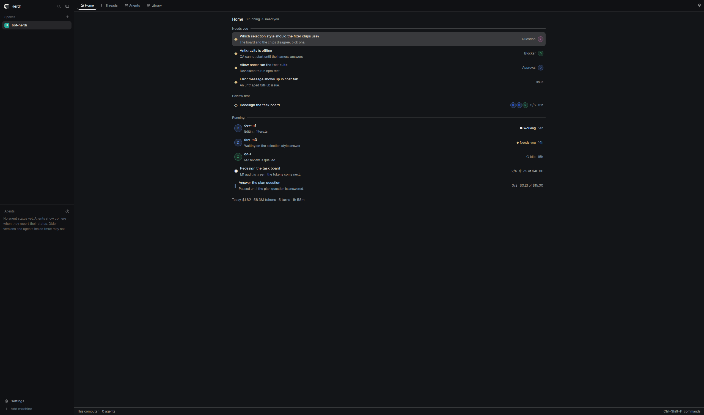

# bot-herdr

A calm control room for a team of coding agents. The person opens it on **Home**: what needs them
on top (questions, blockers, approvals, untriaged issues), reviews next, then every running agent
and Goal with a one-line summary of what it is doing and today's spend. **Threads** holds every
task and plan as one thread (conversation, plan, steps, changes) plus the Orchestrator's chat,
pinned. **Agents** is the fleet and herdr's own terminals; **Library** the team's knowledge,
lessons, scripts and GitHub issues; **Settings** (the gear) the agents, run mode, resilience,
harnesses and usage. Space peeks any row in a right-hand drawer without leaving the list.

## What you see

The layout `layouts/bot-herdr.json` is a row: a 268 px sidebar (herdr's `workspace-chrome`,
`spaces`, `agents` mods; min 44, max 480) and the work column.

- **Top bar** (42 px, `window_drag`): four labelled destinations, **Home, Threads, Agents,
  Library**, and an icon-only **gear** for Settings at the right. The picked one is primary text
  on a grey fill — the app's one selection style. Minimize / maximize / close are
  drawn only where `window().buttons` says the system draws none.
- **Body**: a `stage` stack holding `pages` (the five destinations; Home active) or `terminals`
  (a 40 px Fleet | Terminals strip over herdr's own pane stage).
- **Status bar** (28 px): machine (or "This computer"), branch, "N agents", and the palette key
  ("Ctrl+Shift+P  commands") at the right, in 12 px secondary/muted text on the ground colour with
  a 1 px top edge. Nothing else, no buttons.
- **Pages** draw one centred column, at most 1140 px wide (the chat and composer column 660 px),
  16 px page padding, 12 px between sections. Section labels are 12 px semibold muted text with a
  hairline running to the right.
- **Rows** (thread, agent, need): 44 px minimum, 8 px radius, `hover` fill when picked; state
  glyph at 15 px in its state colour, title 13 px, a one-line summary 12 px secondary, agent
  avatars (20 px initials ringed in the agent's hue), then "2/6 · 3h" muted. Cost, tokens,
  harness and model never sit in a row; they are in the peek.
- **Peek drawer**: 400 px on the right edge of Home, Threads or Agents, surface-1 fill, 1 px left
  edge. Head (glyph, title, close ✕), state word, summary, "harness · model · $0.21 · 412k
  tokens · 10m", "Recent output" (last 5 lines, who · when), the open question as a card with
  numbered option rows, and a reply box with a Send button at the foot.
- **A thread**: a breadcrumb `Threads › <title> › <sub-tab>` (Threads is a link back) and a quiet
  Files button; the second row `Conversation | Plan | Steps | Changes` (segmented, same grey fill).
  Conversation is a feed of entries — type word muted (reply, comment, contract, done…), author
  semibold, age, first line — with the **goal row** (60 px card, 12 px radius) and the
  **composer** pinned at the foot. Plan shows the plan document and an "Open plan" button; Steps
  the task's step cards; Changes "N files · +a −r", the branch as one folded mono line, and a row
  per file with green +added and red −removed.
- **Composer**: at rest one 50 px input line ("Write a message, run a command, or ask an agent");
  focused, it grows a tools row: attach, the space (repo) and branch chip, the Orchestrator's
  model chip, and the round send key.

### Tokens (look.js, the only file with colours)

| Token | Light | Dark | Notes |
| --- | --- | --- | --- |
| `surface0` (`ground`) | `#faf9f5` | `#262624` | page |
| `surface1` (`fill`) | `#ffffff` | `#30302e` | cards, drawer, composer |
| `surface2` (`hover`) | `#f4f3ef` | `#3f3f3d` | picked/hovered row |
| `textPrimary` (`ink`) | `#141413` | `#faf9f5` | |
| `textSecondary` (`muted`) | `#6a6964` | `#bbb9b2` | |
| `textMuted` (`faint`) | `#6a6966` | `#abaaa4` | |
| `accent` | `#a25338` | `#e1987e` | AA-repaired coral; selection, one primary action per view |
| `edge` | `#e3e0d7` | `#4a4a47` | quiet dividers |
| `controlBorder` | derived | derived | ≥ 3:1 on `fill` in every theme |
| `well` | `#ebe9e2` | `#222220` | skeletons, insets |

Any other theme preset is mapped onto the same keys by `palette()` (themes in `themes/`:
bot-herdr, dune, fern, harbor, plum × light/dark; the audit checks all 16 presets herdr ships).

- **Type**: 12 metadata, 13 body, 15 titles, 20 hero; weights 400 and 600 only.
- **Space**: 4 px grid `4 8 12 16 24 32`; **radius** 8 controls, 12 cards; borders, never shadows
  (the composer keeps its one `shadow_md`).
- **States** (glyph + colour + word, never colour alone): Needs you ◆ `warning`, Review ◇ `accent`,
  Working ● `accent`, Done ✓ `success`, Failed ✕ `danger`, Paused ‖ `muted`, Idle ○ `muted`.
- **Agent hues** (avatar ring and initial only, never fills): dev `#5b8def`, design `#d6825a`,
  qa `#3fa877`, research `#a47bd6`, scout `#3ea3b5`, advisor `#c4973b`, orchestrator = accent.

## How it behaves

- Agent and thread state comes from the engine (below), never guessed in the view: needsYou when
  an open user comment, a blocked step, a BLOCKED gate or a pending amendment waits; review while
  QA works; working while a step or child runs; paused, done, failed, idle otherwise.
- **Keys** (every list owns a focus handle): J / K or arrows move the pick (wrapping), Home / End
  jump, Enter opens (a thread, or an agent's terminal), Space toggles the peek for the picked row,
  Esc closes the peek, then goes back from a thread to the list (not while the composer has the
  keyboard). In the peek, 1–9 pick a question option: it gets a ✓, the others fold away, and it is
  sent as the reply. Enter in the reply box sends with `hc send <address>` and stays on the list.
- **Threads list**: groups Needs you → Review → Working → Paused → Done → Failed → Idle; the
  Orchestrator chat pinned first. The search filters title, id, summary and agents; Filter shows
  one chip per state that has threads (with its count); the active filter is one chip with ✕.
- **Goal row**: `◎ Gate 2/6 · 11h · 2 retries left` and the judge's last reason; Pause/Resume
  (`bh goal pause|resume`; resume also wakes the Orchestrator), Edit (puts an amendment request
  in the composer), Clear (`bh goal stop`, needs a second click within 5 s).
- Ctrl+Shift+M (`bot-herdr.focus`), `/settings`, task links and "send from chat" route through
  `pages.js` `showPage`: "chat" opens the Orchestrator thread with the keyboard in its composer;
  `tasks`/`plans` open Threads (a task link opens that thread on Steps); `issues`, `knowledge`,
  `learning`, `scripts` open Library on that sub-tab; `metrics` opens Settings › Usage;
  `terminals` opens Agents › Terminals.
- Pages poll every 10 s only while shown. Reading shows skeleton rows in the final layout, never a
  spinner; an empty page says what will appear and offers the one action that starts it; an error
  says what to do ("Try again, or check that bh is installed").
- Every view renders inside a render-safe boundary (`render-safe.js`): a throw draws a calm
  fallback card (✕, plain sentence, Retry, folded details) and logs once.

## Built from

- **Layout** `layouts/bot-herdr.json`: `root` row → `sidebar` column (`brand`, `sidebar-lists`
  with `spaces` + `agents`, `sidebar-footer`) and `work` column → `topbar` row (`switch` block:
  `{mod:"bot-herdr", props:{view:"switch"}}`), `work-body` → `stage` stack → `pages` stack (`home`,
  `threads`, `agents`, `library`, `settings`, each `{mod:"bot-herdr", props:{view:<id>}}`) and
  `terminals` column (`agents-tabs` block `{view:"agents", sub:"terminals"}` over `panes` →
  `main` `{tab:"active"}` with a `pane` header), then `status` block `{view:"status"}`.
- **One mod, many views** (`main.js` `VIEWS`, picked by `props.view`): `switch`, `home`, `threads`,
  `agents`, `library`, `scripts`, `status`, `chat`, `work`, `issues`, `learning`, `settings`,
  `metrics`, plus dialogs (`pick`, `settings-more`, `lightbox`, `file`, `plan`, `note`) and the
  layout's `toast`. Key files: `pages.js` (destinations, `showPage`, `openThread`, shared keys
  `bot-herdr.open-thread`/`open-task`/`focus`/`sub`), `threads.js`, `peek.js`, `threadview.js`
  (pure models), `statusbar.js`, `home.js`, `agents.js`, `library.js`, `composer.js`, `chat.js`,
  `work.js` (step cards reused by Threads › Steps), `look.js`, `theme.js`, `rowkeys.js`.
- **Engine** (`engine/bh.mjs`, run with `exec`): `bh home --json`, `bh thread list|show|peek
  [<id>] --json`, `bh goal progress <id> --json`, `bh goal pause|resume|stop <id>`, `bh plan show`,
  `bh task show`, `bh scripts list`, `bh metrics`, `bh resilience status`. Thread and Home are
  derived read models over `.bot-herdr/tasks`, `.bot-herdr/plans`, the board, reports and the
  app's reply logs (`DATA/replies/*.jsonl`); corrupt records are skipped and logged to
  `DATA/logs/ui.jsonl`.
- **herdr functions**: `layout`, `run` (`layout.select`, `agent.focus`, `mod.open {name}`,
  `app.palette`), `shared`/`setShared`, `spaces`, `agents`, `terminals`, `panes`, `keys`, `window`,
  `settings`, `hc` (`send`, `put`), `openOverlay`. Shipped mods used: `workspace-chrome`,
  `spaces`, `agents`, `pane`, `files`, `changes` (the last two open as windows).
- **Install** (`install.mjs`): copies the mod and themes, then `installLayout`: no layout →
  written; an installed one → `migrateLayout(old, shipped)` keeps the person's theme, titlebar,
  sizes of shared nodes, active page and any page of their own, drops the old destinations
  (`chat`, `tasks`, `plans`, `metrics`, …), and first copies the old file to
  `bot-herdr.json.<UTC stamp>.bak`; `--force` replaces (still backed up); a current layout is left
  untouched.
- **Audit** (`bh ui-audit [--json] [--shots <dir>]`): renders every page in `AUDIT_PAGES`
  (`engine/lib/ui-audit-fixtures.mjs`, deterministic fixtures) with `herdr-app check --print-spec`,
  scans the source, checks contrast over all 16 presets, counts the Fix table, compares visible
  elements with the M1 baseline of the page(s) each new page replaces (`REPLACES` in
  `ui-audit.mjs`), detects the P1 features by element ids (`bh-thread-*`, `bh-goal-row`,
  `bh-peek`, `bh-home-needs`, `bh-row-summary-*`), and with `--shots` captures PNGs in four themes
  (graphite, paper, ink, moss) from a temp `HERDR_APP_HOME`.
- **Art**: `icons/*.svg` (navigation and icon-only buttons only).

## Watch out

- `on_key_down` fires only on an element with `track_focus`: each list page owns one handle, and
  the peek is drawn inside it (one focus tree), so the page hands keys to `peek.keys()` first.
  Inputs report `focus`/`blur`; while one has the keyboard, J/K/Space are its text.
- An `InputState`'s placeholder is fixed at creation; make them in `init`, never in `render`.
- `herdr-app check` renders only the first frame: a `bh` read started in `init` never lands, so
  audited pages take their data from fixture seeds. It also renders only a stack's active child.
- The shot window initialises every layout block at once and shares one `shared.json`: each page
  resets the remembered sub-tab (`prepare()`) per render. Blocks that are not audited pages (the
  status bar, the Terminals strip) draw as their own view.
- GPUI has no rotate/transform, no colour transitions, no `aria_expanded`; use opacity overlays and
  labels. Composite `#rrggbbaa` theme colours over their surface before checking contrast.
- No hex outside `look.js`; at most one accent (primary) button per view; zero counts are never
  drawn; machine text (paths, branches, JSON, stack traces) is one muted mono line that expands.
- **Approval cards** (`approvalcard.js`, `bh-approval-<id>`): drawn in the Peek when peeking an
  approval row on Home and at the top of a thread's Conversation for pending approvals belonging to
  that thread (`bh approvals list --json`). Shows the agent avatar and name, the title, the held
  command as one folded mono line, and **Allow once** (primary), **Allow for this project** and
  **Deny** (secondary); keys `1`/`2`/`3` answer (`bh approvals answer <id> once|project|deny`) and
  the card folds away over `MOTION.fold`.
- **Diff review with inline comments** (`diffreview.js`, `bh-diff-<path>`, `bh-diff-line-<path>-<new>`,
  `bh-review-comment-<id>`, `bh-review-send`): in Threads › Changes, clicking or pressing Enter on a
  file row expands its diff in place (`bh review diff`), mono with `+`/`−` gutters in `stateDone`/
  `stateFailed` text (no fills) and muted line numbers. Clicking or pressing Enter on a line opens
  one inline comment input (Enter saves via `bh review add`, Esc cancels); comments render beneath
  their line with Remove (`bh review remove`), and **Send to Dev · N** (hidden when 0) sends open
  comments via `bh review send`.
- **Summary / Normal / Verbose** (`bh-view-mode`), **Thread map** (`threadmap.js`, `bh-thread-map`),
  **Fork** (`bh-thread-fork`, `bh-fork-input`), **Queue & steer** (`bh-queue-<n>`, `bh-steer`), and
  **Tiled agent panes** (`bh-agents-tile` using `layout.set` `{ terminal }` blocks): `v` cycles the
  per-thread view mode; children and forks render as a tree under the thread header (Space peeks,
  Enter opens) with clickable "Forked from" origin; Fork opens a prefilled context input (`bh thread
  fork`); Enter queues while the target works and Ctrl+Enter steers (`hc interrupt` then `hc send`).
- Assumes `bh` (Node ≥ 18) and `hc` on PATH, git for the Changes stat, and herdr-app with the
  shipped mods above.

## Done when

- `node_modules/.bin/tsc --noEmit -p mods/bot-herdr/jsconfig.json` and `herdr-app check
  mods/bot-herdr` pass.
- `npm test` passes, including `test/render-resilience.test.mjs` (every view model fuzzed with
  corrupt and legacy data through the boundary, never throwing) and `test/threads-view.test.mjs`.
- `bh ui-audit --json` reports `topLevelDestinations 5`, `renderErrors 0`, `hexOutsideTokens 0`,
  `zeroCountChips 0`, `rawMachineText 0`, `selectionStyles 1`, `accentButtonsPerView ≤ 1`, every
  page under its baseline ceiling, and the threads, goal row, peek, Home needs-you and live-summary
  features present.
- Home opens first; Space on a Home, Threads or Agents row opens the 400 px peek and Esc closes it;
  a thread shows the breadcrumb and the four sub-tabs; the status bar shows machine, branch,
  agent count and the palette key.
- Installing over an old layout keeps a timestamped `.bak` and the person's theme and sizes.
